# How it works

A walk through the method, figure by figure, and how the model plugs into an
API and the web console. Every figure is regenerated by

```bash
cattle3d figures --cowdb2 ../CowDatabase2 --cowdb1 ../CowDatabase
```

which writes the same 15 figures in Ukrainian (`reports/figures/thesis/uk/`,
for the thesis) and English (`reports/figures/thesis/en/`, used below). Numbers
on the schemes are read from the code's constants, and the data figures call
the same functions the model uses, so the figures cannot drift from the code.
Ukrainian captions ready for the thesis are in
[`thesis_figure_captions_uk.md`](thesis_figure_captions_uk.md).

## 1. The pipeline in one picture

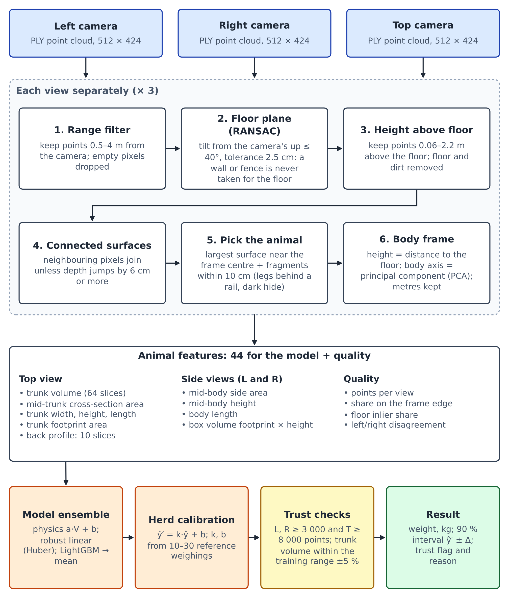

Three Kinect v2 clouds (left, right, top) go through the same six geometric
steps one view at a time, become one row of features, and the model turns that
row into a weight, a 90 % interval and a trust flag. Code:
`pipeline.features_from_clouds()` for the top half,
`WeightModel.predict_row()` for the bottom row.

## 2. What the camera delivers

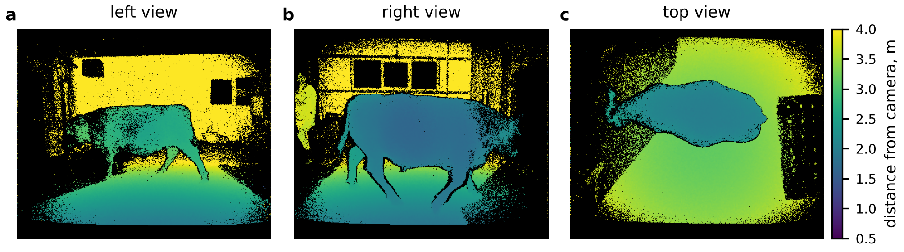

Each cloud is a 512 × 424 grid of 3-D points in metres, in the camera's own
coordinates. Black pixels returned nothing. The example is the median-weight
cow of CowDatabase2 (610 kg), not a hand-picked one. Note the black hide: the
side views have speckle and holes where the infrared signal is absorbed.

## 3. Finding the animal

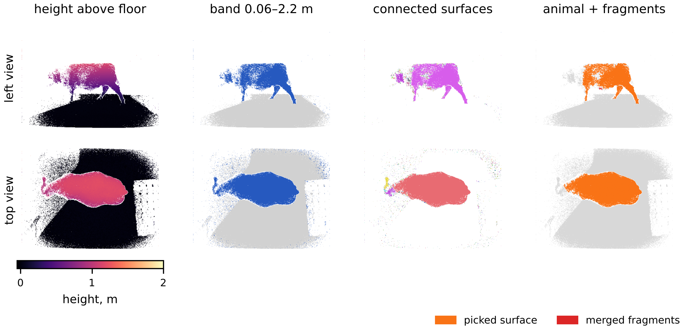

Per view (`geometry/segment.py`, `trace_view()`):

1. **Floor.** RANSAC fits a plane, but only planes tilted at most 40° from the
   camera's expected "up" are allowed, so a wall or fence is never taken for
   the floor. Panel 1 is every pixel's height above that plane.
2. **Band.** Pixels 6 cm to 2.2 m above the floor are kept (blue).
3. **Surfaces.** Neighbouring pixels are joined unless the depth jumps by 6 cm
   or more, so the fence in front of the cow and the wall behind it become
   separate surfaces (colours).
4. **Animal.** The largest surface near the image centre is the animal
   (orange). Fragments that touch it within 10 cm in 3-D and lie inside its
   columns are merged back (red): legs cut off by a rail, speckle on dark hide.

In this example the side view loses the head, which is turned away and
separated by a depth jump. That is why the model leans on mid-body features
rather than full body length.

## 4. Into metres: the body frame

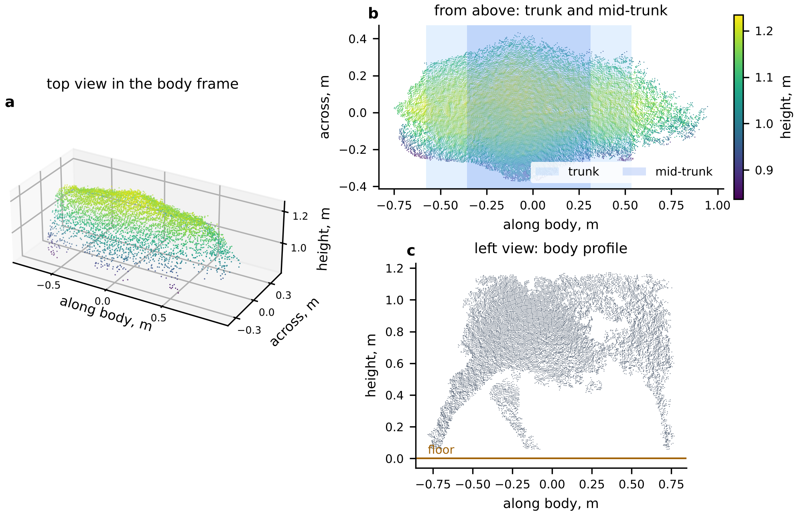

The animal's points are rotated into a frame where height is the distance to
the floor and the body axis is the main horizontal direction (PCA). Nothing is
normalised: a bigger cow stays bigger. (a) The top view is the surface of the
back. (b) Seen from above, the trunk (light blue) and its middle 60 % (dark
blue) are marked. (c) The side view gives the profile; the hole in the barrel
is missing depth on black hide.

## 5. From points to a volume

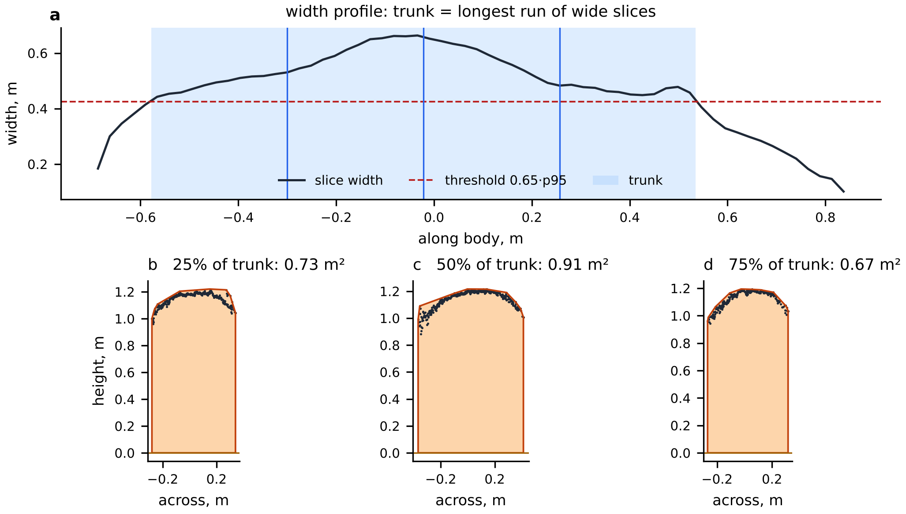

(a) The body is cut into 64 slices along its axis and each slice's width is
measured. The trunk is the longest run of slices wider than 0.65 × the widest
part, which drops the neck, head and tail. (b–d) Each slice's area is the
convex hull of its back profile and that profile's projection on the floor;
summing area × slice thickness gives the **trunk volume**. It is the volume
under the back, not the true body volume (it includes the space between the
legs), which is why the model learns `weight ≈ a·V + b` rather than using a
density.

The top view also gives a **back profile**: the trunk is cut into 10 equal
parts from the head end, and each part contributes its mean cross-section
area, width and height (30 features). Together with the volume, areas and
heights this makes 44 features for the model.

## 6. Does the signal carry weight?

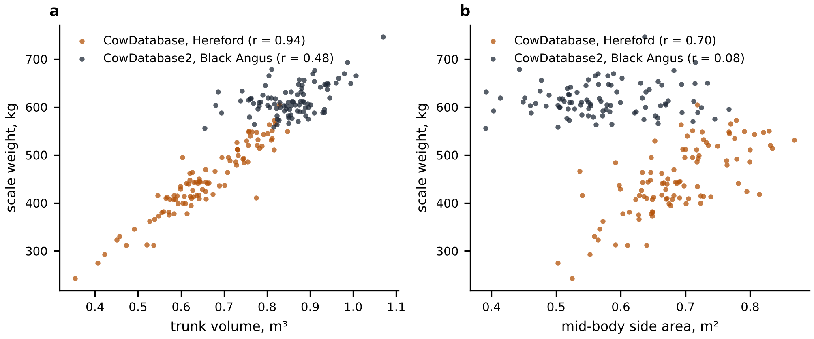

Trunk volume against scale weight. On the Hereford herd (243–605 kg)
r = 0.94. On the Black Angus herd r = 0.48: the weight range there is narrow
(SD 33 kg) and the black hide degrades the depth data, so this herd is the
harder test. The side area alone barely relates to weight on the Angus herd.

## 7. A data finding: the public CowDatabase is mislabelled

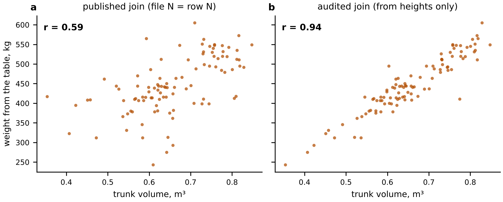

The release pairs cloud file N with table row N. For files 22–87 that is wrong
(off by one or two). The pairing was rebuilt from **heights only**, never
weight (`audit.py`, monotone alignment of measured withers/hip height against
the table). With the corrected join r goes from 0.59 to 0.94. The same check on
CowDatabase2 finds nothing to fix, which shows the audit does not invent
shifts. Details: `reports/cowdb1_join_audit.md`.

## 8. How the claims are tested

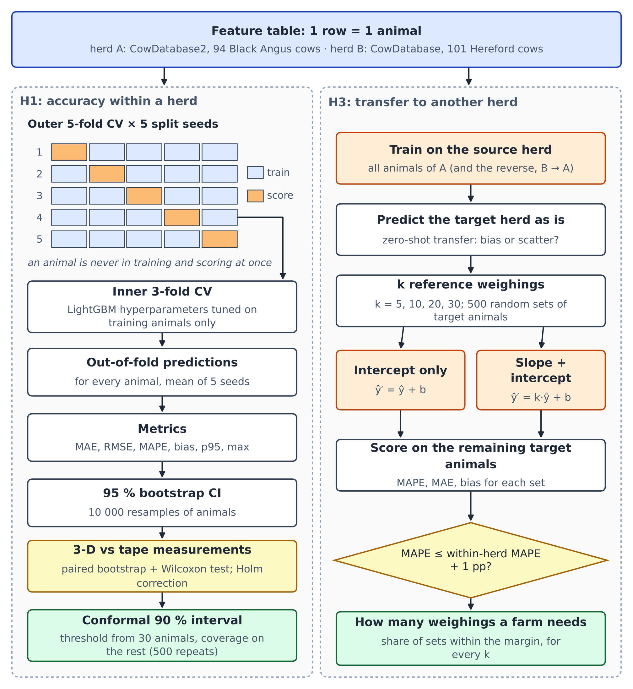

**H1, within a herd.** Outer 5-fold CV over animals, repeated with 5 random
splits; LightGBM is tuned by an inner 3-fold CV on the training animals only,
so no score has seen its own animals. Errors get 95 % bootstrap intervals over
animals, and 3-D is compared with the tape-measurement model on the same
animals (paired bootstrap, Wilcoxon, Holm correction).

**H3, across herds.** Train on one herd, predict the other as is; then draw k
reference animals from the new herd (k = 5, 10, 20, 30; 500 draws), fit a
correction on them, and score the remaining animals against the new herd's own
within-herd MAPE + 1 point.

## 9. Results in pictures

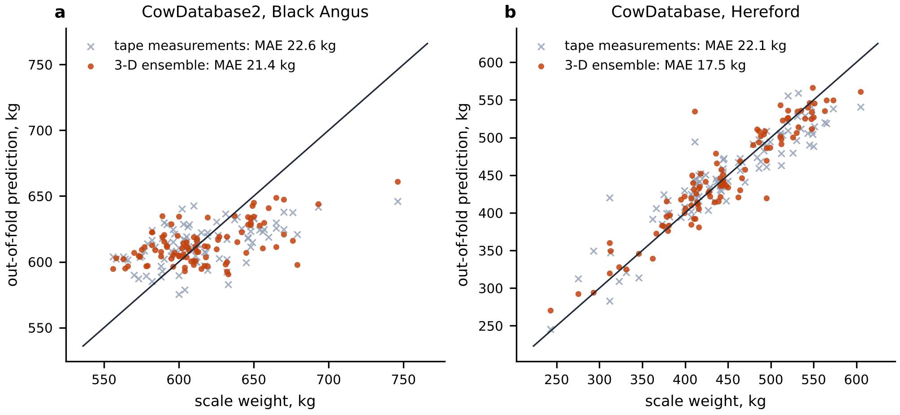

Out-of-fold predictions. Hereford: 3-D MAE 16.1 kg against 22.1 kg for tape
measurements (Holm p = 0.019). Black Angus: 20.7 kg against 22.6 kg, no
claimable difference. These numbers include the 10-slice back profile, which
was picked after comparing eight feature variants on the same animals
(`improvement_headroom.md`); without it the MAEs were 17.5 and 21.4 kg, so the
thesis should report the profile's gain as exploratory.
The Angus predictions are squeezed towards the herd mean (regression to the
mean on a narrow, noisy herd).

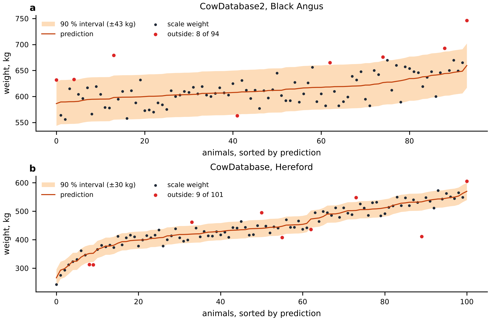

Every animal's 90 % conformal interval: ±42 kg (Angus) and ±30 kg (Hereford);
8 of 94 and 9 of 101 animals fall outside. This picture uses one threshold for
the whole herd, so about 10 % misses is expected by construction; the honest
check is in `reports/results.md` (H4): calibrated on 30 animals and scored on
the rest, coverage is 0.90 on both herds. The deployable model, trained on
both herds, carries ±42.3 kg. After transfer with 20 reference animals the
interval widens to ±54–95 kg, which is the price of a new herd.

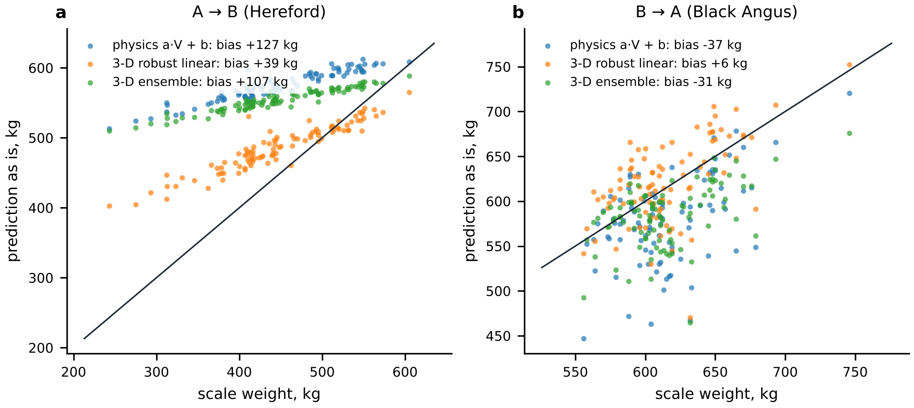

The ensemble moved to the other herd unchanged is mostly off by a shift
(+107 kg Angus → Hereford, −31 kg back; the shift is 88–100 % of the error).
Going from the heavy Angus herd to the lighter Hereford herd the slope is also
flattened: predictions only span about 510–590 kg. The robust linear model
moved from Hereford to Angus happens to have no significant shift (+6 kg,
CI −2 to +13), but its scatter is larger than after recalibration. Both are fixable with a few
weighings, which is the point of H3.

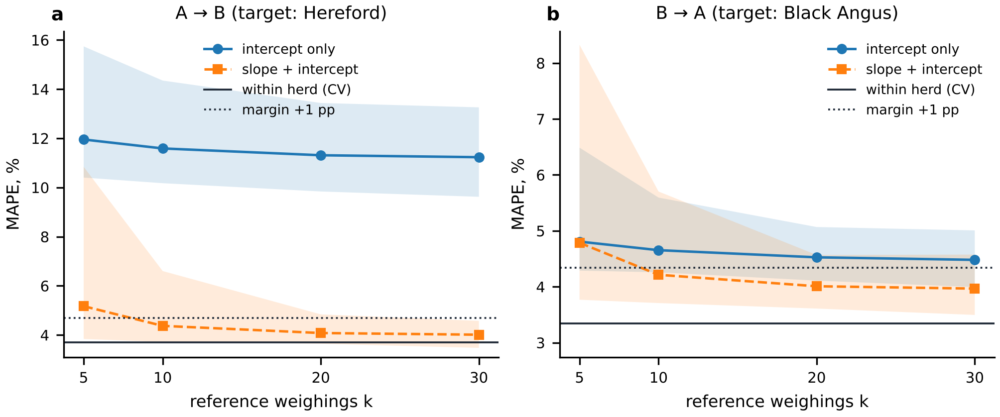

Fixing it: with a slope + intercept correction from 20 weighed animals the
error comes within 1 MAPE point of training on the herd itself (96 % and 90 %
of random reference sets meet the margin at k = 20; 99 % and 92 % at k = 30).
An intercept-only correction is not enough, because the herds differ in slope
too. Practical reading: **a new farm weighs 20–30 animals once.**

## 10. One scan: trust, flag or refuse

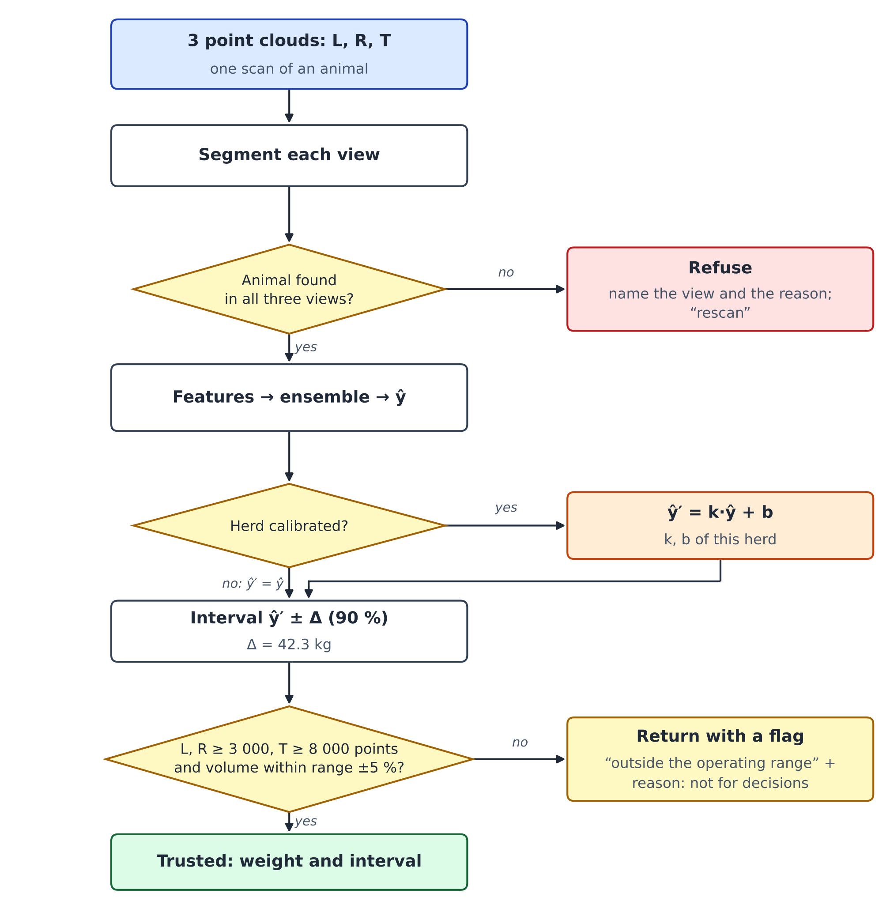

If any view has no animal, there is no number at all, only "rescan" and the
reason. Otherwise the herd's correction is applied, the interval is attached,
and two checks decide the flag: enough points in every view, and trunk volume
inside the training range ± 5 %. A flagged prediction is still returned, with
its reason, but marked as outside the operating range. This is the "when to
withhold" rule the thesis asks for, in code (`WeightModel.predict`).

## 11. Where it goes: integration

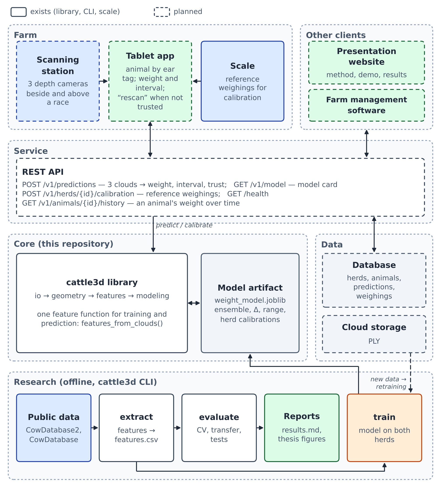

Solid boxes exist today, dashed ones are planned.

- **Core (this repository).** `cattle3d` is a library first. The CLI, the
  experiments and the planned API all call the same
  `features_from_clouds()` → `WeightModel.predict_row()`, so the API computes
  features exactly as training did. The trained model is one file,
  `weight_model.joblib`, with its card (training herds, ranges, CV metrics,
  herd corrections).
- **Service (next step).** A thin REST API over the library:
  `POST /v1/predictions` takes three PLY files and returns the JSON that
  `cattle3d predict` prints today; `POST /v1/herds/{id}/calibration` takes
  reference weighings and stores the herd's k and b; `GET /v1/model` returns
  the card. A database keeps herds, animals, predictions and weighings, so the
  API can show an animal's weight history.
- **Clients.** The React web console (computer and phone) sends the three
  clouds with the ear tag, shows weight ± Δ, asks for a rescan when the result
  is refused or flagged, and manages farms, calibration, drift and animal
  histories over the same API.
  Farm management software can pull weights over the same API.
- **Research loop.** Public data → `extract` → `evaluate` → reports and these
  figures; `train` → the artifact. Scans and weighings collected through the
  API are new labelled data for retraining (dashed).

## 12. A farm's life with the system

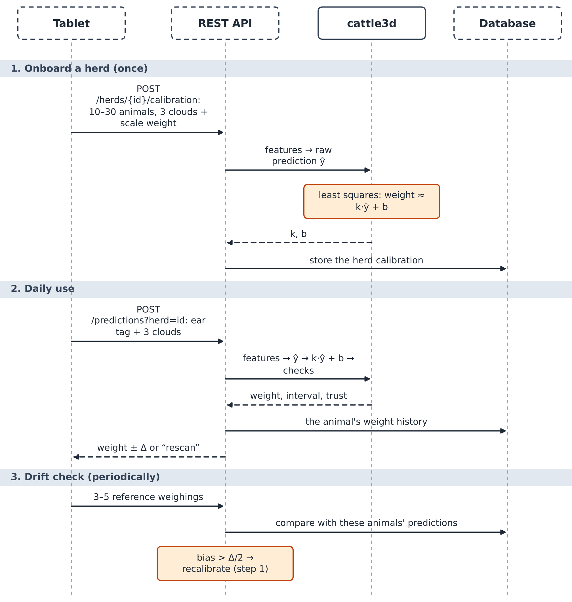

1. **Onboard once:** scan and weigh 10–30 animals; the API fits and stores the
   herd's correction.
2. **Daily:** scan → corrected weight with interval and trust flag → stored in
   the animal's history.
3. **Periodically:** weigh 3–5 animals; if the mean error drifts beyond half
   the interval, recalibrate.

Steps 1 and 2 exist today as `cattle3d calibrate` and `cattle3d predict --herd`;
the API wraps them. Step 3 is a planned API feature.
